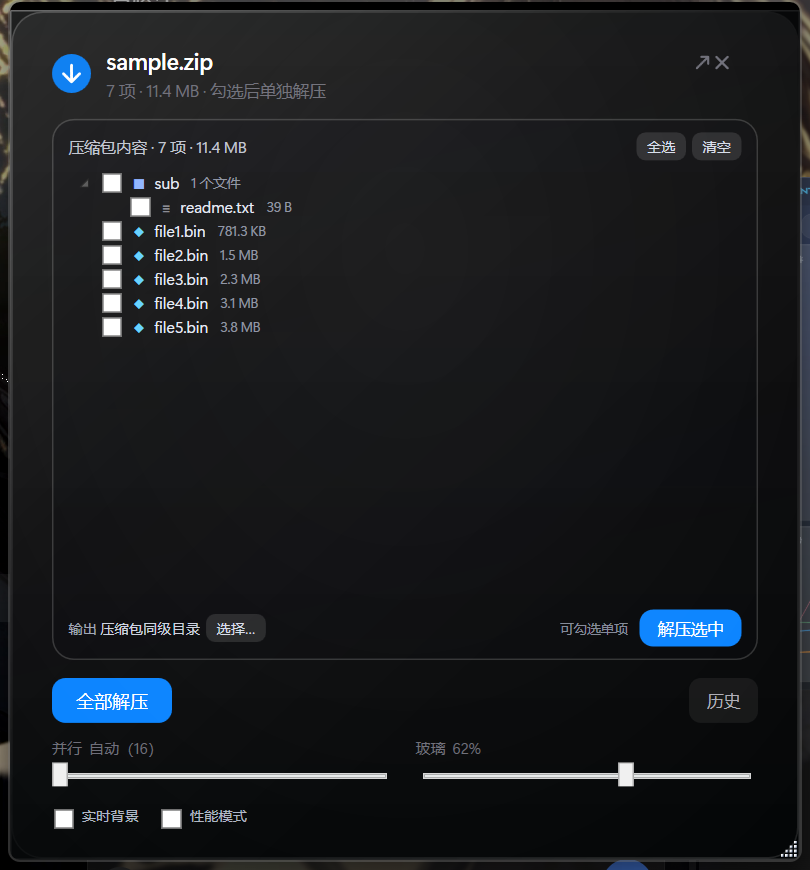

# Liquid Unzip

一个 Windows 上的解压小工具。整个窗口是一块毛玻璃，透出后面的桌面，把压缩包拖进去就开始解。

我平时要处理 ComfyUI 的模型包，动辄一两百 G，用 WinRAR 点一下然后去干别的，回来发现才走了一半。有一次盯着任务管理器看，发现解压的时候只有一个核在跑，剩下的全在睡觉。查了一下才知道 RAR5 的高压缩模式在 7-Zip 里就是单线程的，调参数没用。后来就想着把包拆开、几个进程一起解，速度立刻上来了。这个工具就是这么来的。



## 它做了什么

**多进程并行解压。** 扫一遍包里的清单，大文件（>300MB）一个进程解一个，小文件按包的顺序切成几段，每段一个进程。并发数默认取你机器核心数的一半，最多 16 个。

在一台 32 核的机器上解 187G 的包，单进程大概 70MB/s，四进程能到 180MB/s，再往上反而掉——因为那几个大文件在读同一块 USB 盘，进程开多了光顾着寻道了。

**先看再解。** 拖进压缩包不会直接开始，先把里面的文件列出来，带图标和大小，你可以只勾选想要的那几个。这个对模型包特别有用，我经常只需要一个 VAE 或者一个文本编码器，不想等它把 20G 的 UNet 也解一遍。

**一路都能看见。** 进度环、实时速度曲线，还有下面一栏直接显示 7-Zip 吐出来的当前文件名和百分比。

**能拉成横屏。** 双击标题栏或者点右上角那个箭头，窗口从竖版变成横版，文件树能铺开看。

## 关于那个玻璃

一开始我想做得很花哨，让窗口对截图隐身，然后每一帧抓桌面当背景，再分层做模糊。截图确实好看，但你一拖窗口就知道了——动一下要等半天才跟上来。

后来写了个测试，一项一项拆开量：

| | 每帧耗时 p95 |
|---|---|
| 空窗口 | 18.9ms |
| 只贴一张图，不模糊 | 29.0ms |
| 贴图 + 模糊 | 28.3ms |
| 贴图 + 模糊 + 每帧换图 | 29.9ms |

关键发现是：**模糊几乎不要钱**（29.0 → 28.3）。真正的开销是 `AllowsTransparency=true`——只要在这种窗口里贴上任何东西，WPF 就掉进软件合成，一帧要 29ms。

所以最后改成了系统自带的 Acrylic，由 DWM 在显卡上合成，磨砂的浓淡靠叠一层矢量渐变做出来。改完 p95 从 47ms 降到 22ms，基本和空窗口一样了。

代价是不再能"看到背后窗口在动"，只能透出静态壁纸。所以底栏留了个「实时背景」的开关，想要那个效果可以自己打开，但会慢一点。另外还有个「性能模式」，一键关掉玻璃用纯色，核显或者远程桌面的时候开这个。

这些数据记在 [docs/PERF.md](docs/PERF.md) 里，包括当时踩的坑。

## 安装

去 [Releases](../../releases) 下 `LiquidUnzip-Setup-x.x.x.exe`，双击，没了。

- 装到 `%LOCALAPPDATA%\LiquidUnzip`，不要管理员权限
- 会建桌面和开始菜单的快捷方式，右键菜单里也会多一项
- 想卸载就在「设置 → 应用」里卸，或者跑安装目录里的 `--uninstall`

不需要装 .NET 运行时，用的是系统自带的 .NET Framework 4.x。

## 几个滑杆和开关

- **并行** — 解压开几个进程。`0` 是自动。老机器卡的话往下拉。
- **玻璃** — 磨砂的浓淡。往左更透，能看到壁纸的细节；往右更浑，字更好认。
- **实时背景** — 打开后每一帧真的抓桌面，能看到背后窗口在动。吃 CPU。
- **性能模式** — 关掉玻璃和所有渐变，纯色底。最省资源。

## 从源码构建

```bash
bash tools/build-setup.sh 1.2.0
```

产物在 `release/`。

只用了 Windows 自带的 `csc.exe` 和 GAC 里的 WPF 组件，不需要装 .NET SDK。这是从另一个项目抄过来的做法，好处是编译快、产物小（主程序 84KB）。

```
src/
  Program.cs        入口、单实例、卸载
  Glass.cs          DWM Acrylic 封装、画刷工厂、色板
  Backdrop.cs       桌面抓取（窗口隐身 + StretchBlt 降采样）
  LiquidSurface.cs  玻璃分层合成
  ArchiveView.cs    文件树数据模型、类型图标分类
  Extractor.cs      清单解析、任务规划、多进程调度
  MainWindow.cs     窗口 UI
tools/
  build-setup.sh    一键编译打包
  Setup.cs          安装器，把 payload 塞进单文件 exe
  TestEngine.cs     解压功能测试
  TestSelect.cs     单选解压测试
  TestLive.cs       实时输出测试
  TestDrag2.cs      拖动性能对比测试
  TestReal.cs       真实流程截图
docs/
  PERF.md           拖动卡顿的排查记录
```

## 关于 7-Zip

解压引擎用的是 7-Zip 26.02，`7z.exe` 和 `7z.dll` 直接打在安装包里。

7-Zip 主体是 GNU LGPL，可以随作品分发，但要保留它的许可声明，也得允许用户替换这个组件（直接覆盖安装目录里的 `7z.exe` 就行）。

另外 7-Zip 里的 unRAR 解压代码有个额外限制：不能用来做 RAR 压缩程序。这个工具只解压，不压缩，所以没问题。

## 许可

我写的代码是 MIT。7-Zip 那部分按它自己的许可走，见上面。
